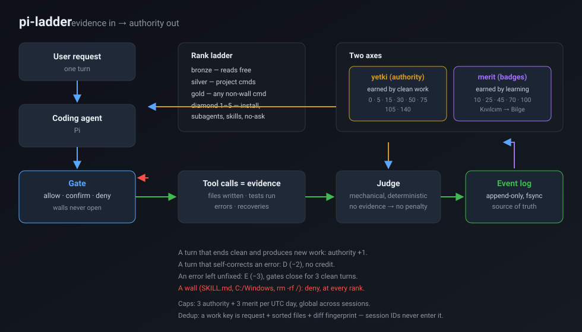

<div align="center">

# pi-ladder

**Your coding agent doesn't get trusted. It gets ranked.**

An evidence-driven reward/penalty layer for [Pi](https://github.com/earendil-works/pi-coding-agent):
clean work buys freedom, mistakes buy friction — and nothing is earned by claiming it.

[](LICENSE)
[](tests/)
[](tools/e2e-senaryo.mjs)
[](package.json)
[](package.json)

**English** · [Türkçe](README.tr.md) · [Nederlands](README.nl.md)

</div>



---

## The problem nobody prices in

Coding agents fail in boring, expensive ways: they edit files they were told not to touch, re-run a failing command five times, guess instead of checking, answer "done" without evidence, and burn your context on a 1,500-character scoreboard nobody reads.

Prompted rules don't fix this — a rule in the system prompt is a *suggestion* the model may drop at step 12. Approvals don't fix it either: when every action asks, you become the bottleneck and start clicking "yes" reflexively.

**pi-ladder treats friction as currency.** The agent starts behind tight gates. Evidence of good work buys it *fewer questions*; evidence of bad work buys it *more*. The agent can see its own rank, badges, and exactly which doors are open — so it never has to guess what it will gain or lose.

It is not a cage. It is a ladder.

---

## 60-second quickstart

```bash
git clone https://github.com/ozguer/pi-ladder.git
cd pi-ladder

node tools/kur.mjs            # dry run — prints the plan, writes nothing
node tools/kur.mjs --yaz      # real install: backup, copy hooks, migrate old scores
```

Restart Pi once (hooks load at startup), then send any request. Within one turn:

```bash
tail -3 ~/.pi/agent/user-character/skorcu.log
# 2026-11-20T15:38:43Z  olay: istek yazildi anahtar=is:b2b18f68e82933764
# 2026-11-20T15:38:43Z  calisti: olay=1 ceza=0 merit=0 yetki=16
```

The installer is deliberately conservative: it **never overwrites** files the agent wrote for itself (`SKILL.md`, learning notes), and it drops a timestamped backup of the previous hooks beside them.

Want to see it work without touching your setup?

```bash
node tools/e2e-senaryo.mjs    # fake Pi session, real hooks, real store — 16 scenarios
```

---

## How the loop works

```
request → gate → tool calls → evidence → judge → event log → two axes → rank → gate …
```

| Stage | What happens | File |
|---|---|---|
| **Gate** | Every tool call is classified (`read` / `write` / `shell` / `other`) and answered with `allow`, `confirm` or `deny` from the current rank. Walls are absolute. | `extensions/kapi-politika.mjs` |
| **Evidence** | The transcript is parsed into facts: files written, commands run, errors (`SyntaxError`, `ENOENT`, `command not found`…), recoveries. | `extensions/skor-yargic.mjs` |
| **Judge** | Deterministic verdict. **No evidence → no penalty.** A recovered error is one D; an unrecovered error is one E — never both. | `extensions/skor-karar.mjs` |
| **Event log** | Append-only JSONL, `fsync`-ed, `mkdir`-locked. The single source of truth; the score is always a fold over this file. | `extensions/skor-store.mjs` |
| **Axes** | `yetki` (authority → rank) and `merit` (badges → learning). Two independent scales, never one blended number. | `extensions/skor-model.mjs` |
| **Rank** | `0 · 5 · 15 · 30 · 50 · 75 · 105 · 140` → bronze, silver, gold, diamond 1–5. Drop a threshold and the doors close **in the same turn**. | `extensions/skor-politika.mjs` |

### Three states of a turn

| State | Condition | Effect |
|---|---|---|
| **Advances** | no D/E, work produced, work unit is new | authority **+1** |
| **Holds** | no D/E, no work (a question, a listing) | **0** — the streak is not broken |
| **Breaks** | D or E | penalty, streak resets, gates tighten |

`D −2` (self-corrected) · `E −3` (unrecovered) · `E/5 −5` (critical).
Rewards: `learning +1` · `discovery +2` · `recovery +2` · `transparency +1` (all on the merit axis).

### Caps, dedup, and why four parallel sessions don't multiply anything

- **Caps:** 3 authority + 3 merit per UTC day, **2 merit per request**, all **global** — opening four Pi windows does not open four wallets.
- **Work key:** `sha256(request text + sorted file list + diff fingerprint)`. Session IDs, window IDs and message IDs are *never* part of it.
- **Window:** work keys deduplicate for 30 days (the same refactor next quarter is new work); lesson keys deduplicate forever (the same lesson is the same lesson).
- **Default is "don't deduplicate":** a caller that forgets a window writes an event instead of silently swallowing one. A spurious `+1` is a small error; a permanently unlearnable turn is a big one.

### Walls

`SKILL.md` · `%SystemRoot%` · `/etc` · `rm -rf /` · `find -delete` · `Format-Volume` · `dd of=` — denied at **every** rank, and a valid session grant cannot override them. Three blocked attempts in one day cost a single E; one blocked attempt costs nothing (no harm was done).

---

## What the agent actually sees

Every request, ~300 characters — not 1,500 — injected as context, never as a prompt the model can edit:

```text
Authority 14 (silver) · next gold: 1 · today 1/3 work units
Merit 0 · badge none (0) · next Spark (10): 10 · duplicates: 0
State: passive · last request: —
Grant: none
If you lose it: gates close in the same request; they reopen after 3 clean requests
Earning: clean request +1 authority · learning +1 merit · discovery +2 merit · recovery +2 merit
```

It is a contract, not a nag: the agent knows its current power, the next rung, and the price of the next mistake. When it earns a badge it is told which doors just opened and how many points remain to the next one.

---

## Design rules that keep it honest

1. **Evidence or nothing.** Every penalty carries a `kanit` string lifted from the transcript; an objection without evidence is rejected and logged.
2. **Walls never open.** Grants cannot override walls; only the wall list can.
3. **One incident, one penalty.** A recovered error isn't billed twice, and recovery is not punished — it just isn't credit.
4. **Fail-safe, not fail-open.** If scoring breaks, the hook logs `karar-hata:` and the score stands still. It never writes a half file, never resets to zero, never guesses.
5. **Session-scoped permissions.** Approvals are written per session file with a sanitized id; path traversal is impossible by construction.
6. **The agent's own files are its own.** The installer and the scorer never overwrite `SKILL.md` or learning notes; they read them as evidence.

---

## Repository map

```
extensions/
  user-character.ts             context hook — injects the short contract
  user-character-rozet.ts       tool_call gate — rank-driven allow/confirm/deny
  user-character-skorcu.ts      turn scorer — evidence → events → views
  user-character-skill-guard.ts hard wall for SKILL.md (headless-safe)
  skor-model.mjs                two axes, work keys, credits, caps
  skor-politika.mjs             the single policy table (thresholds, rewards, caps)
  skor-store.mjs                mkdir lock, fsync append, atomic snapshot
  skor-yargic.mjs               transcript → evidence → verdict
  skor-karar.mjs                verdict → events, evidence-checked objections
  kapi-politika.mjs             gate policy, shell splitting, walls
  oturum.mjs                    per-session permissions, sanitized ids
  skor-gorun.mjs                event log → SCOREBOARD.md / ROZET.md views
tools/
  kur.mjs                       installer (dry-run by default, backup, migration)
  goc.mjs                       one-time migration from the old single score
  e2e-senaryo.mjs               16-scenario end-to-end harness (no live writes)
  check-policy-sync.mjs         docs ↔ policy consistency check
tests/                          280 unit tests (node:test, zero dependencies)
templates/                      the agent-facing contract files (tr + en)
```

**Zero runtime dependencies.** Node 20+. Everything above is plain ESM.

---

## Configure it

All numbers live in one table — `extensions/skor-politika.mjs`:

```js
export const POLICY = {
  thresholds: [0, 5, 15, 30, 50, 75, 105, 140],   // authority → rank
  meritThresholds: [
    { name: "Spark", merit: 10 },   { name: "Trace", merit: 25 },
    { name: "Compass", merit: 45 }, { name: "Lantern", merit: 70 },
    { name: "Sage", merit: 100 },
  ],
  penalties: { D: 2, E: 3, E5: 5 },
  rewards: { learning: 1, discovery: 2, recovery: 2, transparency: 1 },
  caps: { authorityPerDay: 3, meritPerDay: 3, meritPerRequest: 2 },
};
```

Change a number, run `node tools/check-policy-sync.mjs` (it fails if the docs drift), run the tests. That's the whole tuning surface.

---

## Verify it yourself

```bash
node --test tests/                                          # 280 pass, 0 fail
node tools/e2e-senaryo.mjs                                  # 16/16 — clean day
node tools/e2e-senaryo.mjs --canli-gunluk <path/to/jsonl>    # replay against real data
node tools/check-policy-sync.mjs                             # docs ↔ policy: clean
```

The end-to-end harness builds a fake Pi session, drives the **real** hooks, the real judge and the real store in a temporary home directory, and asserts: clean-turn credit, dedup, D vs E, passive gates, wall denial under a valid grant, reactivation after three clean turns, the daily cap, merit from a learning note, and the injected note's length and contents. It cannot touch your live data.

---

## Honest status

- **Works today:** scoring, ranks, gates, walls, caps, dedup, migration, installer, tests, e2e.
- **Known limits:** the merit axis currently fires on `OGRENME/` writes only (discovery and recovery detection are next); the judge reads tool-call evidence, so purely conversational turns score zero by design; the shipped `templates/` are Turkish (the reference user's working language) while `templates/en/` holds English versions.
- **Not a sandbox.** Gates are a friction system for a cooperative agent, not a security boundary. Run the agent in a container if you need isolation.

---

## Contributing

Issues and PRs are welcome. Two ground rules: **no penalty without evidence**, and **every policy number lives in `POLITIKA`** — hard-code a threshold elsewhere and the docs check will fail you.

```bash
npm test          # 280 unit tests
npm run e2e       # 16 end-to-end scenarios
npm run check     # docs ↔ policy sync
```

## License

MIT © Özgür ([@ozguer](https://github.com/ozguer))

Built for [Pi](https://github.com/earendil-works/pi-coding-agent). Not affiliated with the Pi project.
