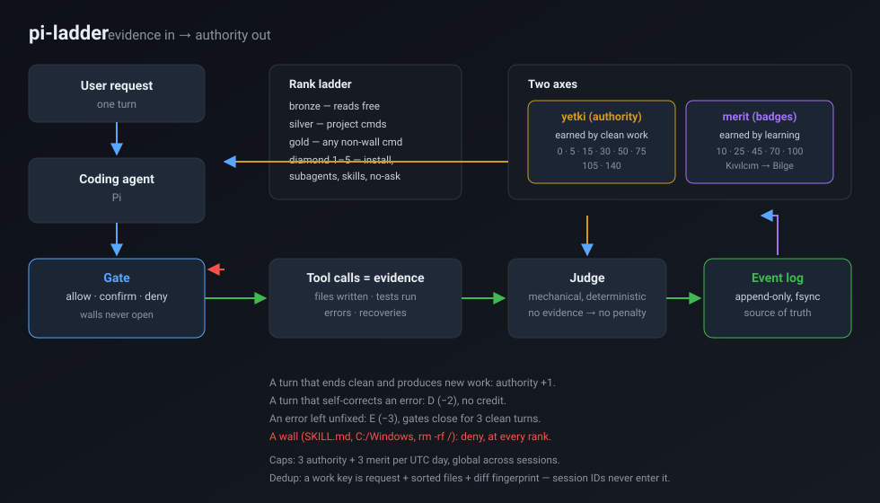

<div align="center">

# pi-ladder

**Je coding-agent wordt niet vertrouwd. Het wordt gerangschikt.**

Een bewijsgestuurde belonings-/strafLaag voor [Pi](https://github.com/earendil-works/pi-coding-agent):
schoon werk koopt vrijheid, fouten kopen wrijving — en niets wordt verdiend door het te beweren.

[](LICENSE)
[](tests/)
[](tools/e2e-senaryo.mjs)
[](package.json)
[](package.json)

[English](README.md) · [Türkçe](README.tr.md) · **Nederlands**

</div>



---

## Het probleem dat niemand meerekent

Coding-agents falen op saaie, dure manieren: ze bewerken bestanden die ze niet mochten aanraken, draaien een falend commando vijf keer opnieuw, gokken in plaats van te controleren, antwoorden "klaar" zonder bewijs, en verbranden je context aan een scorebord van 1.500 tekens dat niemand leest.

Regels in de prompt lossen dat niet op — een regel in de systeemprompt is een *suggestie* die het model bij stap 12 kan laten vallen. Goedkeuringen lossen het ook niet op: als elke actie vraagt, word jij de flessenhals en klik je reflexmatig "ja".

**pi-ladder maakt van wrijving een valuta.** De agent begint achter strakke poorten. Bewijs van goed werk koopt *minder vragen*; bewijs van slecht werk koopt *meer*. De agent ziet zijn eigen rang, zijn badges en precies welke deuren open staan — dus hij hoeft nooit te raden wat hij wint of verliest.

Het is geen kooi. Het is een ladder.

---

## Installatie in 60 seconden

```bash
git clone https://github.com/ozguer/pi-ladder.git
cd pi-ladder

node tools/kur.mjs            # proefrun — toont het plan, schrijft niets
node tools/kur.mjs --yaz      # echte installatie: back-up, hooks kopiëren, oude score migreren
node tools/kur.mjs --yaz --dil nl   # Nederlandse sjablonen (en · tr · nl)
```

Herstart Pi één keer (hooks laden bij het starten), stuur daarna een verzoek. Binnen één beurt:

```bash
tail -3 ~/.pi/agent/user-character/skorcu.log
# 2026-11-20T15:38:43Z  olay: istek yazildi anahtar=is:b2b18f68e82933764
# 2026-11-20T15:38:43Z  calisti: olay=1 ceza=0 merit=0 yetki=16
```

De installer is bewust voorzichtig: hij **overschrijft nooit** bestanden die de agent voor zichzelf schreef (`SKILL.md`, leernotities) en zet een getimede back-up van de vorige hooks ernaast.

Zonder je opstelling aan te raken zien hoe het werkt?

```bash
node tools/e2e-senaryo.mjs    # nep-Pi-sessie, echte hooks, echte opslag — 16 scenario's
```

---

## Hoe de lus werkt

```
verzoek → poort → tool-aanroepen → bewijs → rechter → gebeurtenissenlog → twee assen → rang → poort …
```

| Fase | Wat gebeurt er | Bestand |
|---|---|---|
| **Poort** | Elke tool-aanroep wordt geclassificeerd (`read` / `write` / `shell` / `other`) en beantwoord met `allow`, `confirm` of `deny` op basis van de huidige rang. Muren zijn absoluut. | `extensions/kapi-politika.mjs` |
| **Bewijs** | Het transcript wordt geparseerd tot feiten: geschreven bestanden, uitgevoerde commando's, fouten (`SyntaxError`, `ENOENT`, `command not found`…), herstel. | `extensions/skor-yargic.mjs` |
| **Rechter** | Deterministisch oordeel. **Geen bewijs → geen straf.** Een herstelde fout is één D; een niet-herstelde fout is één E — nooit beide. | `extensions/skor-karar.mjs` |
| **Log** | Append-only JSONL, `fsync`, `mkdir`-slot. De enige bron van waarheid; de score is altijd een fold over dit bestand. | `extensions/skor-store.mjs` |
| **Assen** | `yetki` (autoriteit → rang) en `merit` (badges → leren). Twee onafhankelijke schalen, nooit één gemengd getal. | `extensions/skor-model.mjs` |
| **Rang** | `0 · 5 · 15 · 30 · 50 · 75 · 105 · 140` → brons, zilver, goud, diamant 1–5. Zakt een drempel, dan sluiten de deuren **in dezelfde beurt**. | `extensions/skor-politika.mjs` |

### Drie toestanden van een beurt

| Toestand | Voorwaarde | Effect |
|---|---|---|
| **Vordert** | geen D/E, werk geleverd, werkeenheid nieuw | autoriteit **+1** |
| **Blijft staan** | geen D/E, geen werk (een vraag, een lijst) | **0** — de reeks blijft intact |
| **Breekt** | D of E | straf, reeks gereset, poorten sluiten |

`D −2` (zelf gecorrigeerd) · `E −3` (niet hersteld) · `E/5 −5` (kritiek).
Beloningen: `leren +1` · `ontdekken +2` · `herstel +2` · `transparantie +1` (alle op de merit-as).

### Plafonds, deduplicatie en waarom vier parallelle sessies niets vermenigvuldigen

- **Plafonds:** 3 autoriteit + 3 merit per UTC-dag, **2 merit per verzoek**, alles **globaal** — vier Pi-vensters openen geen vier portemonnees.
- **Werksleutel:** `sha256(verzoektekst + gesorteerde bestanden + diff-vingerafdruk)`. Sessie-, venster- en bericht-id's zitten er *nooit* in.
- **Venster:** werksleutels dedupliceren 30 dagen (dezelfde refactor volgend kwartaal is nieuw werk); lessleutels dedupliceren voor altijd (dezelfde les is dezelfde les).
- **Standaard is "niet dedupliceren":** een aanroeper die een venster vergeet schrijft een gebeurtenis in plaats van er stil één in te slikken. Een onterechte `+1` is een kleine fout; een beurt die nooit meer kan leren is een grote.

### Muren

`SKILL.md` · `%SystemRoot%` · `/etc` · `rm -rf /` · `find -delete` · `Format-Volume` · `dd of=` — geweigerd bij **elke** rang, en een geldige sessie-toestemming kan ze niet openen. Drie geblokkeerde pogingen op één dag kosten één E; één geblokkeerde poging kost niets (er is geen schade).

---

## Wat de agent werkelijk ziet

Bij elk verzoek, ~300 tekens — geen 1.500 — als context geïnjecteerd, nooit als een prompt die het model kan bewerken:

```text
Authority 14 (silver) · next gold: 1 · today 1/3 work units
Merit 0 · badge none (0) · next Spark (10): 10 · duplicates: 0
State: passive · last request: —
Grant: none
If you lose it: gates close in the same request; they reopen after 3 clean requests
Earning: clean request +1 authority · learning +1 merit · discovery +2 merit · recovery +2 merit
```

Het is een contract, geen gezeur: de agent kent zijn huidige macht, de volgende trede en de prijs van de volgende fout. Als hij een badge verdient, hoort hij welke deuren net opengingen en hoeveel punten er nog zijn tot de volgende.

---

## Ontwerpregels die het eerlijk houden

1. **Bewijs of niets.** Elke straf draagt een `kanit`-string uit het transcript; een bezwaar zonder bewijs wordt verworpen en gelogd.
2. **Muren gaan nooit open.** Toestemmingen kunnen muren niet overschrijven; alleen de murenlijst kan dat.
3. **Eén incident, één straf.** Een herstelde fout wordt niet dubbel gefactureerd, en herstel wordt niet bestraft — het is alleen geen krediet.
4. **Fail-safe, niet fail-open.** Breekt de scoring, dan logt de hook `karar-hata:` en blijft de score staan. Nooit een half bestand, nooit een reset, nooit een gok.
5. **Toestemmingen per sessie.** Goedkeuringen worden per sessiebestand geschreven met een opgeschoonde id; path traversal is constructief onmogelijk.
6. **De eigen bestanden van de agent zijn van de agent.** De installer en de scorer overschrijven `SKILL.md` of leernotities nooit; ze lezen ze als bewijs.

---

## Repository-overzicht

```
extensions/
  user-character.ts             context-hook — injecteert het korte contract
  user-character-rozet.ts       tool_call-poort — allow/confirm/deny op rang
  user-character-skorcu.ts      beurtscorer — bewijs → gebeurtenissen → weergaven
  user-character-skill-guard.ts harde muur voor SKILL.md (headless-veilig)
  skor-model.mjs                twee assen, werksleutels, kredieten, plafonds
  skor-politika.mjs             de enige beleidstabel (drempels, beloningen, plafonds)
  skor-store.mjs                mkdir-slot, fsync-append, atomaire snapshot
  skor-yargic.mjs               transcript → bewijs → oordeel
  skor-karar.mjs                oordeel → gebeurtenissen, bewijsgecontroleerde bezwaren
  kapi-politika.mjs             poortbeleid, shell-splitsing, muren
  oturum.mjs                    toestemmingen per sessie, opgeschoonde id's
  skor-gorun.mjs                gebeurtenissenlog → SCOREBOARD.md / ROZET.md
tools/
  kur.mjs                       installer (proefrun standaard, back-up, migratie)
  goc.mjs                       eenmalige migratie van de oude enkele score
  e2e-senaryo.mjs               16-scenario end-to-end harness (schrijft niet live)
  check-policy-sync.mjs         documentatie ↔ beleid consistentiecheck
tests/                          280 unit-tests (node:test, geen afhankelijkheden)
templates/                      de contractbestanden (en · tr · nl)
```

**Nul runtime-afhankelijkheden.** Node 20+. Alles hierboven is gewone ESM.

---

## Configureren

Alle getallen staan in één tabel — `extensions/skor-politika.mjs`:

```js
export const POLICY = {
  thresholds: [0, 5, 15, 30, 50, 75, 105, 140],   // autoriteit → rang
  meritThresholds: [
    { name: "Spark", merit: 10 },   { name: "Trace", merit: 25 },
    { name: "Compass", merit: 45 }, { name: "Lantern", merit: 70 },
    { name: "Sage", merit: 100 },
  ],
  penalties: { D: 2, E: 3, E5: 5 },
  rewards: { learning: 1, discovery: 2, recovery: 2, transparency: 1 },
  caps: { authorityPerDay: 3, meritPerDay: 3, meritPerRequest: 2 },
};
```

Verander een getal, draai `node tools/check-policy-sync.mjs` (faalt als de documentatie afwijkt), draai de tests. Dat is het hele afsteloppervlak.

---

## Zelf verifiëren

```bash
node --test tests/                                          # 280 pass, 0 fail
node tools/e2e-senaryo.mjs                                  # 16/16 — schone dag
node tools/e2e-senaryo.mjs --canli-gunluk <pad/naar/jsonl>   # naspelen op echte data
node tools/check-policy-sync.mjs                             # docs ↔ beleid: schoon
```

De end-to-end harness bouwt een nep-Pi-sessie, drijft de **echte** hooks, de echte rechter en de echte opslag in een tijdelijke thuismap, en controleert: krediet voor een schone beurt, deduplicatie, D versus E, passieve poorten, muurweigering ondanks geldige toestemming, reactivering na drie schone beurten, het dagplafond, merit uit een leernotitie, en lengte en inhoud van de geïnjecteerde notitie. Je live data blijven buiten schot.

---

## Eerlijke status

- **Werkt vandaag:** scoring, rangen, poorten, muren, plafonds, deduplicatie, migratie, installer, tests, e2e.
- **Bekende grenzen:** de merit-as vuurt nu alleen op schrijfacties in `OGRENME/` (ontdekking en herstel volgen); de rechter leest alleen bewijs uit tool-aanroepen, dus puur conversationele beurten scoren per ontwerp nul; de sjablonen zijn beschikbaar in het Engels, Turks en Nederlands.
- **Geen sandbox.** Poorten zijn een wrijvingssysteem voor een coöperatieve agent, geen beveiligingsgrens. Draai de agent in een container als je isolatie nodig hebt.

---

## Bijdragen

Issues en PR's zijn welkom. Twee basisregels: **geen straf zonder bewijs**, en **elk beleidsgetal staat in `POLICY`** — hardcode een drempel ergens anders en de documentatiecheck laat je zakken.

```bash
npm test          # 280 unit-tests
npm run e2e       # 16 end-to-end scenario's
npm run check     # docs ↔ beleid sync
```

## Licentie

MIT © Özgür ([@ozguer](https://github.com/ozguer))

Gebouwd voor [Pi](https://github.com/earendil-works/pi-coding-agent). Niet verbonden aan het Pi-project.
