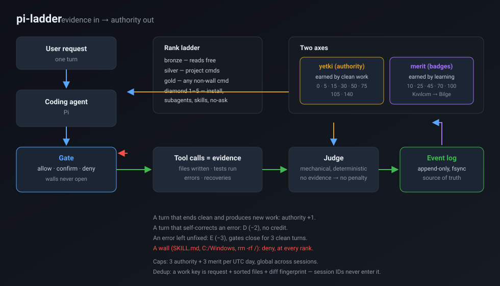

<div align="center">

# pi-ladder

**Kodlama ajanın güven kazanmaz — rütbe kazanır.**

[Pi](https://github.com/earendil-works/pi-coding-agent) için kanıta dayalı ödül/ceza katmanı:
temiz iş özgürlük satın alır, hata sürtünme — ve hiçbir şey iddia edilerek kazanılmaz.

[](LICENSE)
[](tests/)
[](tools/e2e-senaryo.mjs)

[English](README.md) · **Türkçe** · [Nederlands](README.nl.md)

</div>



---

## Çözdüğü sorun

Kodlama ajanları sıkıcı ve pahalı biçimlerde hata yapar: dokunmaması söylenen dosyaları düzenler, başarısız komutu beş kez tekrar çalıştırır, doğrulamak yerine tahmin eder, kanıtsız "tamam" der ve kimsenin okumadığı 1.500 karakterlik skorborda bağlam harcar.

Sistem istemine yazılan kural bunu çözmez — o bir *öneridir*, model 12. adımda düşürebilir. Her işlem onay isterse de çözülmez: bu kez darboğaz sen olursun ve refleksle "evet"e basarsın.

**pi-ladder sürtünmeyi para birimi yapar.** Ajan dar kapılarla başlar. İyi iş kanıtı *daha az soru* satın alır; kötü iş kanıtı *daha çok*. Ajan kendi rütbesini, rozetlerini ve hangi kapıların açık olduğunu görür — ne kazanıp ne kaybedeceğini tahmin etmek zorunda kalmaz.

Kafes değil, merdiven.

---

## 60 saniyede kurulum

```bash
git clone https://github.com/ozguer/pi-ladder.git
cd pi-ladder

node tools/kur.mjs                    # kuru çalışma: planı gösterir, hiçbir şey yazmaz
node tools/kur.mjs --yaz              # gerçek kurulum: yedek, kancalar, göç
node tools/kur.mjs --yaz --dil tr     # Türkçe şablonlarla (en · tr · nl)
```

Pi'yi bir kez kapat-aç, sonra bir istek ver. İlk turdan sonra `~/.pi/agent/user-character/skorcu.log` dosyasına bak.

Kurulum aracı temkinlidir: ajanın kendi yazdığı dosyaları (`SKILL.md`, öğrenme notları) **asla ezmez**, önceki kancaların zaman damgalı yedeğini bırakır.

Kendi kurulumuna dokunmadan görmek için:

```bash
node tools/e2e-senaryo.mjs    # sahte Pi oturumu, gerçek kancalar — 16 senaryo
```

---

## Döngü nasıl işler

```
istek → kapı → araç çağrıları → kanıt → yargıç → olay günlüğü → iki eksen → rütbe → kapı …
```

| Aşama | Ne olur | Dosya |
|---|---|---|
| **Kapı** | Her araç çağrısı sınıflandırılır (`read`/`write`/`shell`/`other`) ve rütbeye göre `allow` / `confirm` / `deny` alır. Duvarlar mutlaktır. | `extensions/kapi-politika.mjs` |
| **Kanıt** | Transcript'ten olgular çıkarılır: yazılan dosyalar, çalışan komutlar, hatalar, düzeltmeler. | `extensions/skor-yargic.mjs` |
| **Yargıç** | Deterministik karar. **Kanıt yoksa ceza yok.** Düzeltilmiş hata bir D, düzeltilmemiş hata bir E — asla ikisi birden. | `extensions/skor-karar.mjs` |
| **Günlük** | Yalnız eklenen JSONL, `fsync`, `mkdir` kilidi. Tek doğru kaynak. | `extensions/skor-store.mjs` |
| **Eksenler** | `yetki` (otorite → rütbe) ve `merit` (rozet → öğrenme). İki bağımsız ölçek. | `extensions/skor-model.mjs` |
| **Rütbe** | `0 · 5 · 15 · 30 · 50 · 75 · 105 · 140` → bronz, gümüş, altın, elmas 1–5. | `extensions/skor-politika.mjs` |

### Turun üç hâli

| Hâl | Koşul | Etki |
|---|---|---|
| **İlerler** | D/E yok, iş üretildi, iş birimi yeni | yetki **+1** |
| **Durur** | D/E yok, iş yok (soru, liste) | **0** — seri bozulmaz |
| **Kırılır** | D veya E | ceza, seri sıfır, kapılar kapanır |

`D −2` (kendi düzeltti) · `E −3` (düzeltmedi) · `E/5 −5` (kritik).
Ödüller: `öğrenme +1` · `keşif +2` · `kurtarma +2` · `şeffaflık +1` (merit ekseninde).

### Tavanlar, tekilleştirme ve dört pencere

- **Tavanlar:** günde 3 yetki + 3 merit, **istek başına 2 merit**, hepsi **global**.
- **İş anahtarı:** `sha256(istek metni + sıralı dosyalar + diff parmak izi)`; oturum kimliği anahtara girmez.
- **Pencere:** iş 30 gün, ders ömür boyu tekilleşir.
- **Varsayılan "tekilleştirme yok"** — pencereyi unutan çağrı olayı yazar, sessizce yutmaz.

### Duvarlar

`SKILL.md` · `%SystemRoot%` · `/etc` · `rm -rf /` · `find -delete` · `Format-Volume` · `dd of=` — **her** rütbede reddedilir; geçerli oturum izni bile açamaz. Günde üç engellenen deneme tek bir E; tek deneme cezasız.

---

## Ajanın gördüğü şey

Her istekte ~300 karakter (1.500 değil), bağlam olarak eklenir — modelin düzenleyebileceği bir komut değil:

```text
Authority 14 (silver) · next gold: 1 · today 1/3 work units
Merit 0 · badge none (0) · next Spark (10): 10 · duplicates: 0
State: passive · last request: —
Grant: none
If you lose it: gates close in the same request; they reopen after 3 clean requests
Earning: clean request +1 authority · learning +1 merit · discovery +2 merit · recovery +2 merit
```

---

## Sistemi dürüst tutan kurallar

1. **Kanıt yoksa hiçbir şey yok.** Her ceza transcript'ten alınmış bir `kanit` taşır.
2. **Duvarlar asla açılmaz.** İzinler duvarı ezemez.
3. **Bir olay bir ceza.** Düzeltilen hata iki kez faturalanmaz; düzeltmek cezalandırılmaz, yalnız kredi sayılmaz.
4. **Fail-safe, fail-open değil.** Skor bozulursa kanca `karar-hata:` yazar ve puan durur.
5. **Oturum bazlı izin.** Onaylar temizlenmiş kimlikle yazılır; yol enjeksiyonu imkânsız.
6. **Ajanın dosyaları ajanındır.** Kurulum ve skorcu `SKILL.md`'yi ezmez.

---

## Yapılandırma ve doğrulama

Bütün sayılar tek tabloda: `extensions/skor-politika.mjs` (`thresholds`, `meritThresholds`, `penalties`, `rewards`, `caps`).

```bash
node --test tests/                       # 280 geçti
node tools/e2e-senaryo.mjs               # 16/16
node tools/check-policy-sync.mjs         # docs ↔ politika: temiz
```

## Dürüst durum

- **Bugün çalışıyor:** skor, rütbe, kapılar, duvarlar, tavanlar, tekilleştirme, göç, kurulum, testler, e2e.
- **Bilinen sınırlar:** merit ekseni şimdilik yalnız `OGRENME/` yazımında tetikleniyor; yargıç yalnız araç kanıtı okur.
- **Sandbox değil.** Kapılar işbirlikçi bir ajan için sürtünme sistemidir, güvenlik sınırı değil.

## Lisans

MIT © Özgür ([@ozguer](https://github.com/ozguer)) · [Pi](https://github.com/earendil-works/pi-coding-agent) için yapıldı, Pi projesiyle bağlantılı değildir.
